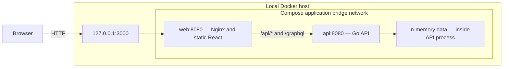
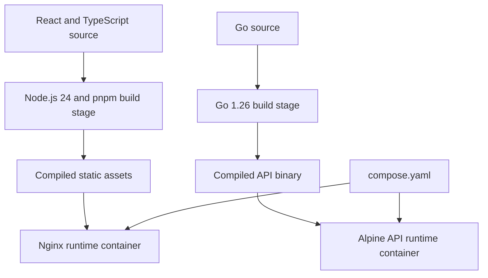
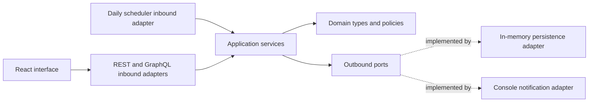

# Order Management Dashboard

A full-stack application for managing orders and communication between buyers,
sellers, and operations teams. Buyers can ask questions about their orders,
sellers can reply, and buyers can approve those answers. Operations users can
inspect orders, filter their dashboard, and trigger priority reviews.

The application is a runnable demonstration with synthetic accounts and data.
It includes a React interface, a Go API, and a two-container deployment using
Docker Compose. Data is held in memory and resets when the API restarts.

## Features

| Role | Capabilities |
| --- | --- |
| Seller | View orders, read buyer questions, and submit answers |
| Buyer | View orders, create questions, and approve seller answers |
| Operations | Filter orders and run manual priority reviews |

The backend also runs a daily priority review scheduler and dispatches seller
notification events through a console driver. Notification delivery is simulated;
no external email provider is configured.

## Quick start

Install Docker Engine with the Compose plugin, or Docker Desktop. Ensure local
port `3000` is available, then run from the repository root:

```bash
docker compose up --build -d --wait
```

Open [http://127.0.0.1:3000](http://127.0.0.1:3000).

### Demo accounts

| Role | Email | Password |
| --- | --- | --- |
| Seller | `seller@example.com` | `seller-demo-password` |
| Buyer | `buyer@example.com` | `buyer-demo-password` |
| Operations | `ops@example.com` | `ops-demo-password` |

Additional seeded accounts appear on the login page. These are intentionally
public demonstration credentials, not production credentials.

## Technology stack

| Layer | Technologies |
| --- | --- |
| User interface | React, TypeScript, Vite |
| API and business logic | Go; module language version 1.22, Docker builder 1.26 |
| API interfaces | REST commands and reads; authenticated, read-only GraphQL using `graphql-go` |
| Storage | In-memory store with deterministic seed data |
| Web runtime | Nginx serving the compiled frontend and proxying API requests |
| Containers | Multi-stage Docker builds, Alpine runtime images, Docker Compose |
| Package management | pnpm 10.12.1 and a committed lockfile; Node.js 24 in the frontend builder |
| Tests | Go testing, Vitest, Playwright |

See [frontend/package.json](frontend/package.json),
[frontend/pnpm-lock.yaml](frontend/pnpm-lock.yaml), and
[backend/go.mod](backend/go.mod) for dependency declarations and resolved versions.
The Dockerfiles pin their base images by digest.

## Deployment architecture

The default deployment has **two runtime containers**. Node.js and the Go compiler
are build-stage tools, not additional running services. There is no database
container or external notification service.



- Only the web container publishes a host port, bound to loopback.
- Nginx serves the frontend and proxies `/api/` and `/graphql` to `api:8080`.
- Compose service-name DNS resolves `api` on the shared bridge network.
- The API port is not published to the host.
- Both containers have health checks; web startup waits for a healthy API.
- Both runtime processes run as non-root users.
- The containerized frontend uses same-origin requests through Nginx.

### Build and runtime flow



Deployment configuration lives in [compose.yaml](compose.yaml),
[frontend/Dockerfile](frontend/Dockerfile),
[frontend/nginx.conf](frontend/nginx.conf), and
[backend/Dockerfile](backend/Dockerfile).

## Application architecture

The backend uses lightweight hexagonal boundaries. Domain and application code
are independent of transport handlers, concrete persistence, and notification
providers. The composition root wires the adapters to the application services.



REST handles state-changing operations. GraphQL provides authenticated,
read-only dashboard composition; it does not expose mutations. See the
[API contract](specs/api-contract.md) and
[architecture documentation](docs/architecture/README.md) for detailed routes
and boundaries.

## Running without containers

Use Go compatible with the module, Node.js compatible with the frontend tooling
(Node.js 24 is used by the Docker build), and pnpm 10.12.1 through Corepack.
With ports `3000` and `8080` available:

```bash
cd frontend
corepack pnpm install --frozen-lockfile
corepack pnpm run start
```

The combined start script launches the Go API on port `8080` and Vite on port
`3000`. Unlike the container build, local Vite connects directly to port `8080`.
The Docker build sets `VITE_API_MODE=same-origin`; leave it unset for this local
workflow. Local development servers bind beyond loopback, so use a trusted
local environment rather than exposing them publicly.

## Operating the container deployment

```bash
# Inspect service state and logs.
docker compose ps
docker compose logs --tail=100 api web

# Check the public proxy and internal container-to-container route.
curl --fail http://127.0.0.1:3000/api/health
docker compose exec -T web wget -qO- http://api:8080/api/health

# Reset demonstration data; wait for healthy services before using the UI.
docker compose restart api web
docker compose ps

# Stop and remove the deployment containers and network.
docker compose down
```

Both API health requests return `{"status":"ok"}`. Restarting the API discards
runtime changes and restores the seeded data; there is no persistent volume.

## Tests

Backend checks, from `backend/`:

```bash
go test ./...
go vet ./...
```

Frontend checks, from `frontend/`:

```bash
corepack pnpm run test-frontend
corepack pnpm run build
```

Browser tests against running containers, from `frontend/`:

```bash
corepack pnpm install --frozen-lockfile
corepack pnpm exec playwright install chromium
corepack pnpm exec playwright test --config playwright.container.config.ts
```

The container test configuration uses the existing deployment instead of
starting local Go or Vite servers. For repeatable browser runs, reset the API's
seeded data first. See the [testing guide](docs/development/TESTING_GUIDELINES.md)
and [recorded execution evidence](evidence/README.md).

## Repository map

```text
backend/
  cmd/api/                    API executable entry point
  internal/domain/            Domain types and policies
  internal/application/       Use cases and outbound ports
  internal/adapters/          HTTP, GraphQL, scheduler, storage, notifications
  internal/bootstrap/         Dependency wiring
frontend/                     React UI, Vite configuration, and browser tests
docs/                         Architecture, decisions, and development guides
specs/                        API and behavior contracts
evidence/                     Recorded logs and demonstration screenshots
compose.yaml                  Two-container deployment definition
```

## Scope and limitations

This is a demonstration application, not a production commerce platform. The
current deployment has no durable database, external email delivery, TLS
termination, or production identity-provider integration. Do not expose the
running demo to the public Internet with its seeded accounts. Publishing the
source repository does not require publishing the running application.

## Further documentation

- [Documentation index](docs/README.md)
- [Backend guide](backend/README.md)
- [Frontend guide](frontend/README.md)
- [Architecture and deployment boundaries](docs/architecture/README.md)
- [Design decisions](docs/decisions/README.md)
- [Specifications](specs/README.md)

## License

No license file is currently included. Public repository visibility alone does
not grant an open-source license.
