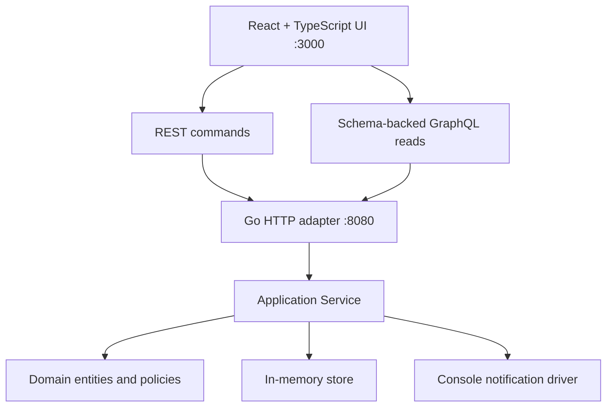

# Architecture Explained

## System view



**[DOCUMENTADO]** ADR-001 chooses a lightweight hexagonal monolith. **[OBSERVADO]** The source has domain, application, inbound/outbound adapters, bootstrap, and command packages.

## Dependency direction

```text
domain <- application <- adapters <- bootstrap/cmd
```

The arrow means outer code may depend on inner code. Domain code must not import HTTP, React, persistence, scheduler, GraphQL, or stdout.

### Why this direction matters

- Domain rules can be tested without starting a server.
- The application asks for capabilities through interfaces.
- Memory or notification implementations can be replaced.
- HTTP remains a delivery mechanism, not the owner of business truth.

Putting ownership checks in React would be insecure. Putting priority scoring in a handler would duplicate it across HTTP and scheduler entry points. Putting console output in the domain would make the rule depend on a provider detail.

## Domain

`internal/domain/model.go` owns the core data and two calculations: order totals and priority.

`Order.Total` uses the item’s stored `UnitPrice`, satisfying the purchase-time-price invariant. `EvaluatePriority` is deterministic:

```text
keyword score: Critical=80, otherwise High=60, otherwise 0
waiting score: 5 per full day, capped at 30
value score: floor(order value / 100), capped at 20
total: capped at 100
classification: Critical>=80, High>=60, Medium>=30, Low otherwise
```

Matched words are sorted to make the result stable. The dictionary version is stored by the application, so a later policy can be distinguished from prior classifications.

**[RECOMENDACIÓN]** Money should use integer minor units or a decimal type in production; `float64` can accumulate rounding errors.

## Application

`internal/application/service.go` defines `Store` and `Delivery` ports and coordinates all use cases.

| Use case | Application responsibility |
| --- | --- |
| Login | Match seed credentials and issue a one-hour token |
| Read orders | Apply ownership, filters, and deterministic sorting |
| Create question | Validate ownership/body/item/duplicate, classify, save |
| Reply | Validate seller ownership and lifecycle, attach one reply |
| Approve | Validate buyer ownership and transition to closed/resolved |
| Queue | Compose question, order, seller, buyer, waiting days; sort |
| Review | Reclassify eligible questions and delegate notification delivery |

**[DEFENSA]** Application owns orchestration because it combines domain policy with repository and delivery ports. **[RECOMENDACIÓN]** The current single service should be split by use case when independent teams, transaction boundaries, or change rates make the file difficult to maintain.

## Inbound adapter

`internal/adapters/inbound/http/router.go`:

- selects routes,
- reads JSON,
- rejects unknown fields,
- handles CORS,
- extracts bearer tokens,
- maps application errors to HTTP status codes,
- converts domain values into response objects.

CORS belongs here because it is a browser/HTTP boundary policy. Ownership belongs in application because another inbound adapter must enforce the same rule.

### GraphQL boundary

**[DOCUMENTADO]** GraphQL is read-only, role-shaped UI composition. TASK-003B explicitly called for backend GraphQL/JWT dependencies, a schema, and the `viewer`, Seller, Buyer, and Operations read models.

**[OBSERVADO]** `internal/adapters/inbound/graphql/schema.graphql` defines the query contract and intentionally has no `Mutation` root. `handler.go` parses it with `graph-gophers/graphql-go`, authenticates before execution, authorizes roles in resolvers, and delegates business work to the application service. The engine supplies field selection, variables, aliases, fragments, validation, and introspection.

**[DEFENSA]** GraphQL is a read BFF (backend for frontend): it diagrams and composes the data each role’s UI needs. It is not a second command or business-rule layer. REST remains the only mutation boundary, preventing two competing ways to change lifecycle state.

**[INFERIDO]** The exact dependency used by the inaccessible original is not recoverable. Version `v1.6.0` is therefore a reconstruction choice, while the read-only schema boundary itself is documented.

## Outbound adapters

The memory store uses `sync.RWMutex` and returns defensive copies, including nested mutable slices and pointers. It persists only for the process lifetime.

`NotifiableFactory` converts a `Seller` or `OpsTeamMember` into a generic notification target and defensively copies its list of channel identifiers. The application resolves the seller target and follows those identifiers; it does not infer routing by comparing email strings. This is the key decoupling point: the target declares channel intent, not provider implementation.

The dispatcher owns a registry keyed by channel type. It skips disabled channels and deterministically rejects unsupported enabled types. For the MVP it maps the logical `email` type to `Console`, whose injected `io.Writer` prints a JSON payload that simulates sending the email. A future real email or Slack driver can be registered without changing domain entities, priority classification, or review orchestration. Ops members are seeded as notifiable targets too, although the approved MVP alert flow currently targets sellers.

## Bootstrap and command

`bootstrap.Handler` creates memory, console delivery, the application service, and the router. `cmd/api/main.go` listens on `:8080`.

The scheduler is an inbound adapter with an injected clock/timer. It computes the next 00:00 UTC window, invokes `ReviewScheduled`, recovers panics at the process boundary, and stops on cancellation. Bootstrap composes it and `main` starts it without blocking HTTP. Memory provides atomic one-winner window acquisition.

## Growth criteria

Keep the monolith while:

- one deployable unit is operationally sufficient,
- domain boundaries remain understandable,
- synchronous calls meet requirements,
- scaling characteristics are similar.

Consider splitting only when ownership, scaling, reliability, or release independence creates a measurable need. A directory boundary alone is not a reason to create a network boundary.
