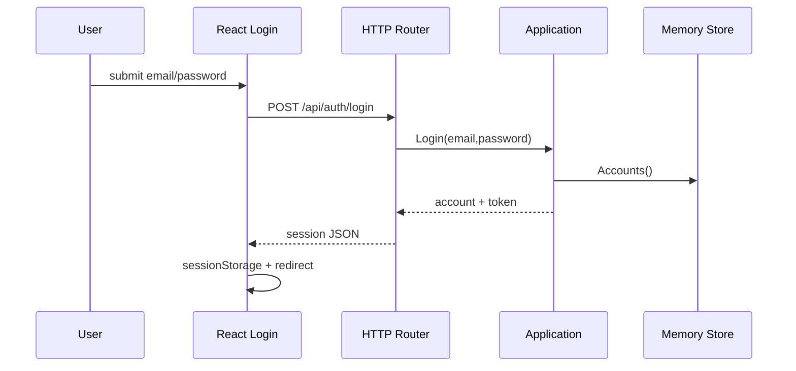
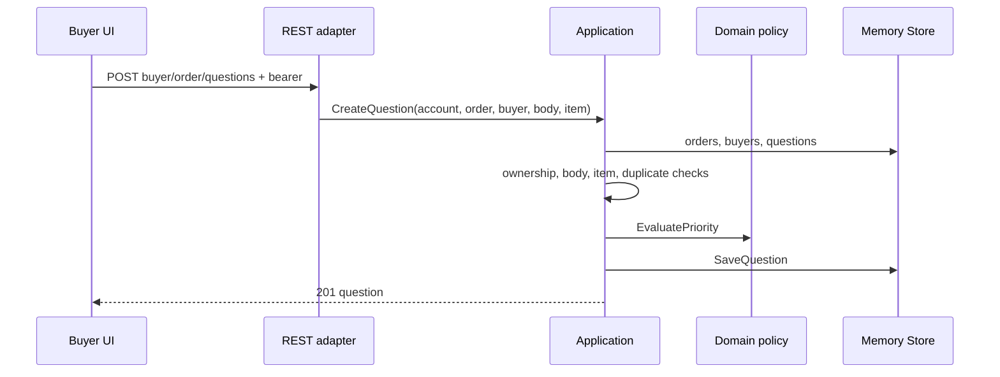

# End-to-End Flows

## 1. Login



The frontend is responsible for form state and navigation. The router is responsible for JSON/HTTP. Application is responsible for credential matching and token issuance. Memory owns seeded accounts.

Errors: invalid credentials become 403; malformed body becomes 400. **[BRECHA]** Passwords and signing secret are hard-coded for the MVP.

## 2. Seller order reads

The Seller component posts a query containing `sellerDashboard` or `sellerOrderDetail`. The shared client adds the token. The router authenticates, compares the account’s SellerID to the variable, calls application order reads, composes item/question JSON, and returns `data`.

Sorting and ownership belong in application so they are not dependent on GraphQL. Rendering and local filtering belong in React.

The GraphQL adapter validates the document against the schema, enforces matching Seller identity in the resolver, applies filter variables, and returns only the requested field selection.

## 3. Buyer question creation



REST expresses a state-changing command. The application prevents an authenticated buyer from targeting another buyer/order. Priority is calculated at creation using a pure domain function.

Potential outcomes: 400 invalid body/item; 401 bad token; 403 ownership; 404 resource; 409 open duplicate.

## 4. Seller reply and buyer approval

```text
question_active/open
    -- seller reply -->
seller_answered/open
    -- owning buyer approval -->
closed/resolved
```

The seller endpoint rejects blank, resolved, already-replied, or foreign questions. Approval requires the owning buyer, an existing reply, and `seller_answered`.

The coarse status preserves open/resolved compatibility. Lifecycle status explains who must act next. Neither is an order status.

## 5. Operations queue

The Operations UI asks for `operationsPriorityQueue`. Application selects only open questions, composes related data, and sorts by score, age, value, and ID.

Both GraphQL and REST queue reads authenticate and explicitly require the Operations role.

## 6. Manual review

Operations posts `/api/operations/priority-review`. The adapter authenticates and checks the Operations role. Application:

1. counts open questions;
2. reclassifies those at least 48 hours since last categorization;
3. builds the current queue;
4. selects High/Critical entries;
5. groups by seller;
6. creates one event per matching enabled channel;
7. delegates delivery;
8. returns counts.

The endpoint accepts an optional `reviewedAt`, useful for deterministic verification but potentially dangerous if exposed without strict operational policy.

## 7. Notification delivery

The event records question IDs, target, channel, date, grouping key, classes, message, and timestamp. `NotifiableFactory` creates generic targets for seeded Sellers and Operations members. A target owns channel IDs; review resolves the seller target, then its enabled channel objects, instead of coupling routing to the seller email field.

The dispatcher selects a driver by logical channel type. For the MVP, `email` is registered to the console driver, which emits JSON to an injected writer and thereby simulates sending the email. `Console` is an adapter implementation, not a domain channel type. Slack or real email can later be registered without changing classification or target construction.

**[OBSERVADO]** The grouping key always includes a manual nanosecond suffix. Repeated manual calls can resend.

**[VERIFICADO]** Scheduled execution-window deduplication exists and is atomic in memory; manual review intentionally adds an auditable override suffix. **[RECOMENDACIÓN]** Delivery status persistence, outbox processing, retries, and provider acknowledgements remain production evolution.

## 8. Intended scheduled review

```text
daily 00:00 UTC scheduler
→ acquire review window
→ invoke shared review use case
→ suppress duplicate window
→ default notification grouping
```

This flow is now **[OBSERVADO]** and tested: the scheduler calculates midnight UTC, supports cancellation, calls the shared use case, and relies on atomic in-memory window acquisition to return `already_executed` for duplicates.
