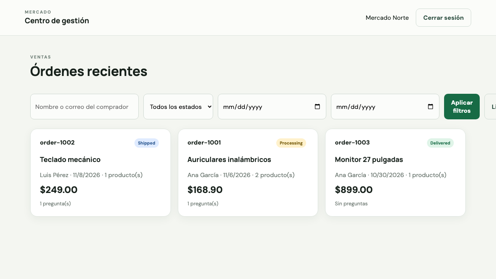
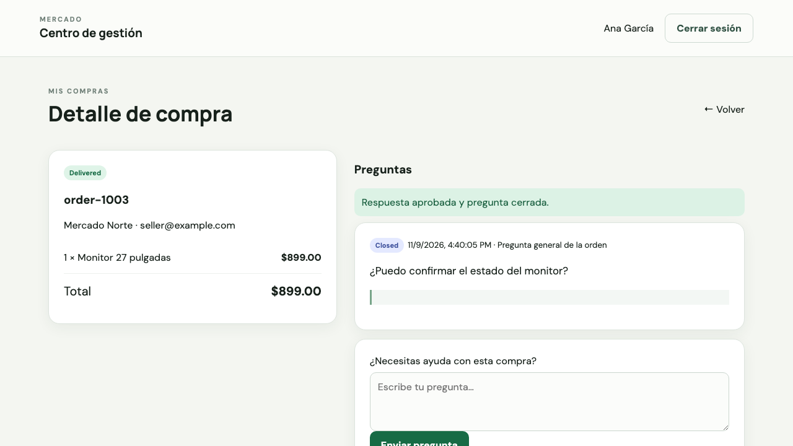
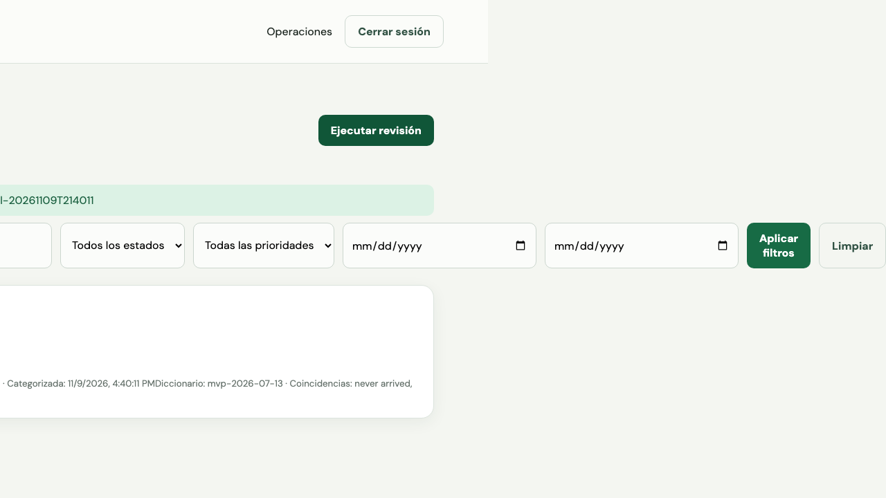

# Verified container evidence

Run date: 2026-11-09. Host: macOS arm64. Docker Desktop 4.99.0; Engine 29.9.3.

| Check | Observed result |
| --- | --- |
| Test-first URL change | Two new same-origin tests failed before implementation; three existing tests passed |
| Focused URL/session tests | 5 passed after implementation |
| Full frontend suite | 7 passed across 2 files |
| Backend suite | All 6 packages with tests passed; 3 other packages contain no tests |
| Go vet | Exit 0 |
| TypeScript and Vite production build | Exit 0 |
| Compose configuration and image build | Exit 0 |
| Runtime services | Exactly api and web, both healthy |
| Internal web to api request | HTTP success and status ok |
| Browser through web proxy to api | HTTP success and status ok |
| Browser tests against containers | 3 passed |

The first local Go test invocation was blocked by sandbox cache access. The suite
was rerun with a temporary writable cache and completed successfully. This was an
environment failure, not a passing test or an application defect.

## Captured output

- [Container state, internal request, proxy request, network and runtime users](container-checks.txt)
- [Browser test output](browser-tests.txt)

## Browser screenshots

These are actual Playwright end-of-test screenshots against the running containers,
not mockups. They contain synthetic case-study users and transactions only.

### Seller login and dashboard

### Buyer approval after seller response

### Operations review

## First-delivery alignment

The course project guide, page 3, requires a GitHub project and two Docker containers
communicating with each other. Source and container configuration satisfy the
repository component; the captured runtime and internal HTTP check demonstrate the
container requirements. Jenkins is assigned to delivery 2, not this delivery.
